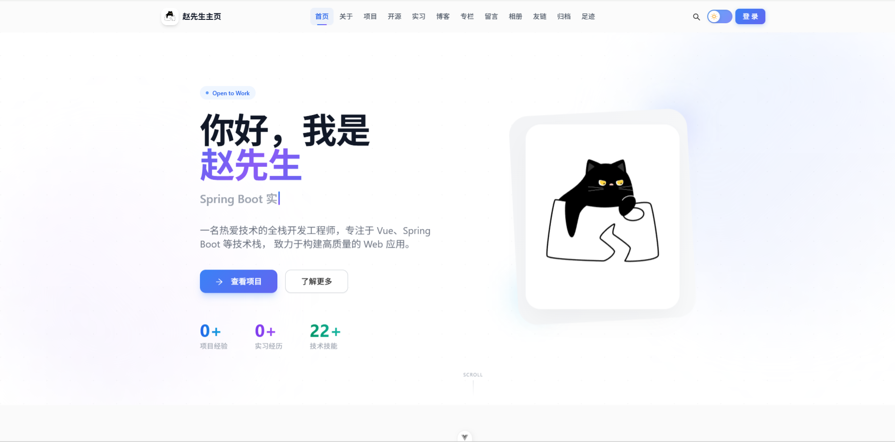
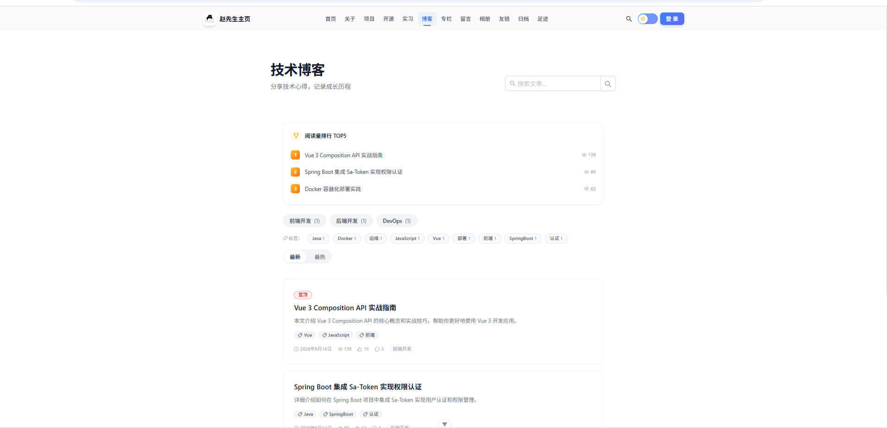
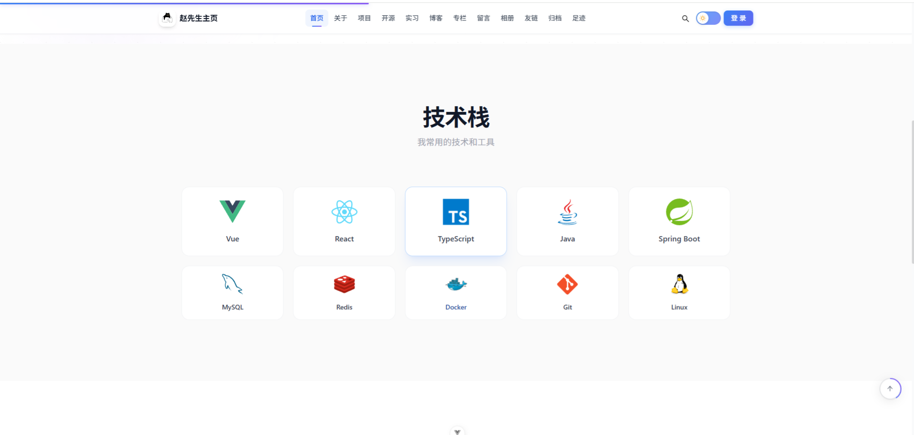
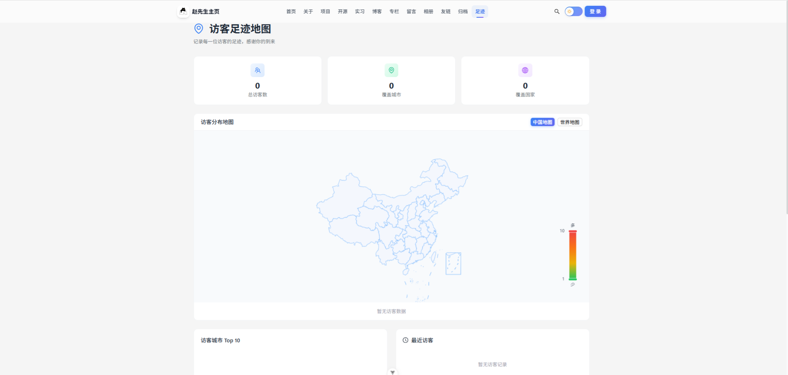
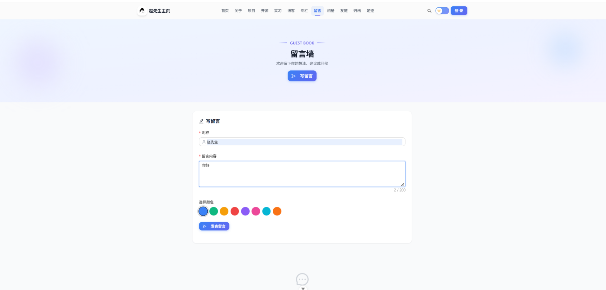
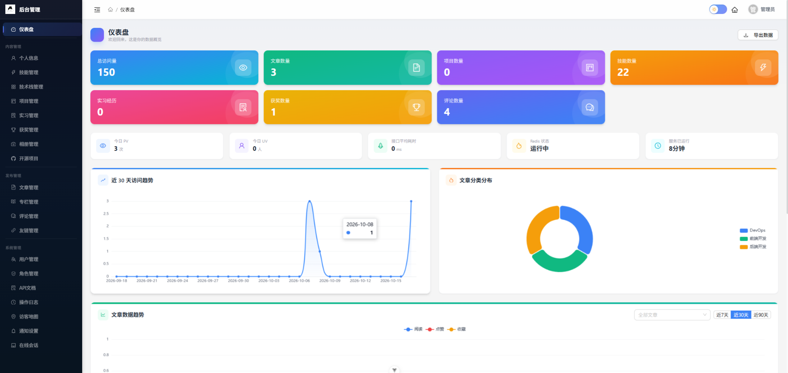
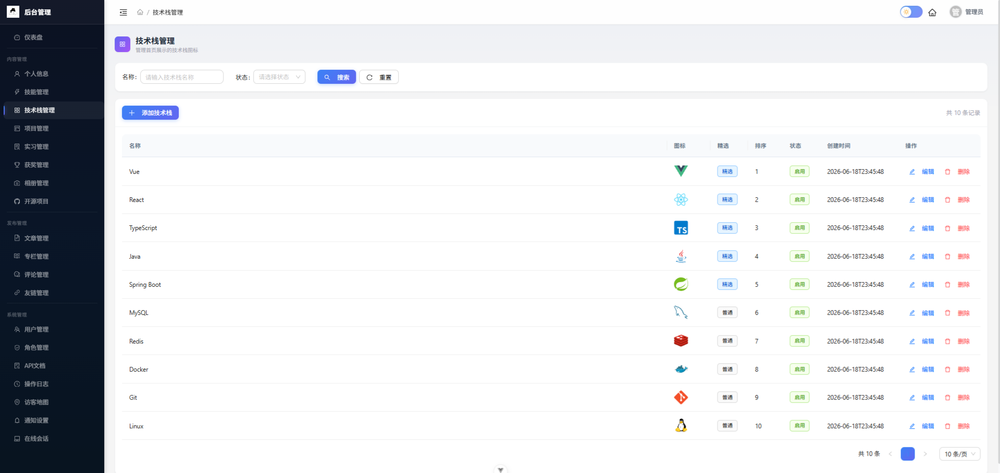
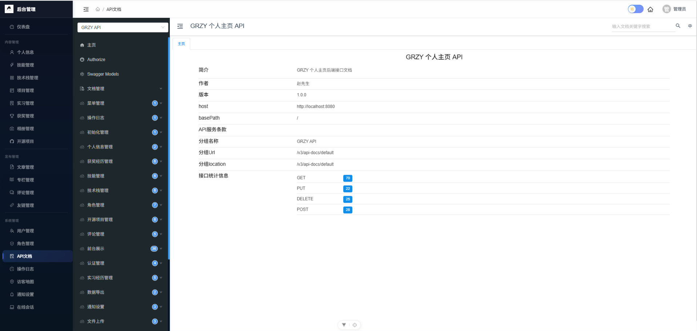
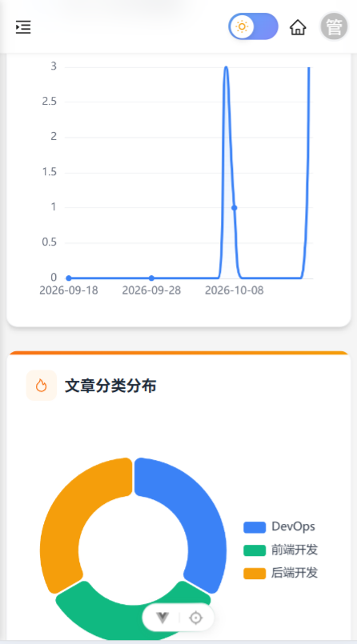

# personal-homepage — 个人主页 / 博客系统

一个功能完善的个人主页与博客系统，集内容创作、项目展示、社交互动、后台管理于一体。

基于 **Spring Boot 3 + Vue 3** 全栈技术栈构建，采用 **Ant Design Vue + Tailwind CSS** 双 UI 体系，支持暗黑模式、PWA 离线访问、移动端适配。

> 站点的所有内容（个人信息、技能、项目、文章、相册、友链等）均可在后台可视化管理，无需修改代码即可维护整站。

## 项目展示

### 电脑端

| 首页 | 博客 | 关于 |
|------|------|------|
|  |  |  |

| 技能展示 | 访客足迹 | 留言墙 |
|------|------|------|
|  |  |  |

### 后台管理

| 仪表盘 | 信息管理 | API 文档 |
|------|------|------|
|  |  |  |

### 移动端

| 首页 | 仪表盘 |
|------|------|
|  |  |

## 技术栈

> 具体的项目部署和替换相关信息的文件在 [docs/notice.md](./docs/notice.md) 里面都有标识
### 后端

| 技术 | 版本 | 用途 |
|------|------|------|
| Spring Boot | 3.2.5 (Java 17) | 应用框架 |
| MyBatis-Plus | 3.5.6 | ORM（Lambda + mapper.xml 双轨） |
| Sa-Token | 1.38.0 | RBAC 权限认证 + 分布式会话 |
| Redis (Lettuce) | — | 缓存 / 防刷 / 分布式锁 |
| MySQL | 5.7+ | 关系型数据库 |
| Druid | 1.2.21 | 数据库连接池 + SQL 监控 |
| Knife4j | 4.5.0 | API 文档（Swagger 增强） |
| Hutool | 5.8.27 | Java 工具库 |
| ip2region | 2.7.0 | 离线 IP 地理位置解析 |
| Spring Mail | — | 邮件通知 |

### 前端

| 技术 | 版本 | 用途 |
|------|------|------|
| Vue 3 | 3.5.x | 前端框架（Composition API + `<script setup>`） |
| Vite | 8.x | 构建工具 |
| Ant Design Vue | 4.x | UI 组件库 |
| Tailwind CSS | 3.4.x | 原子化 CSS |
| Pinia | 2.x | 状态管理 |
| Vue Router | 4.x | 路由（权限路由 + 动态菜单） |
| ECharts | 6.x | 数据可视化（仪表盘图表） |
| Markdown-it | 14.x | Markdown 渲染 |
| md-editor-v3 | 6.x | Markdown 编辑器 |
| Highlight.js | 11.x | 代码高亮 |
| @unhead/vue | 3.x | SEO Meta 管理 |
| vite-plugin-pwa | 1.3.x | PWA 离线支持 |

## 功能概览

### 前台页面

| 页面 | 路由 | 说明 |
|------|------|------|
| 首页 | `/home` | Hero 动画、技术栈展示、技能分类 |
| 个人信息 | `/profile` | 简历式个人介绍 |
| 项目展示 | `/project` | 简历型项目经历 |
| 开源项目 | `/opensource` | Gitee/GitHub 开源项目展示（Star/Fork 同步） |
| 实习经历 | `/internship` | 实习时间线 |
| 技术博客 | `/article` | 文章列表（分类/标签/关键词筛选） |
| 文章详情 | `/article/:id` | Markdown 渲染、目录导航、阅读进度、评论 |
| 专栏系列 | `/series` | 文章系列归集 |
| 留言墙 | `/guestbook` | 公开留言 + 点赞 |
| 相册 | `/album` | 分组相册 + EXIF 拍摄参数 |
| 友情链接 | `/links` | 友链展示 + 在线申请 |
| 文章归档 | `/archive` | 按时间归档 |
| 访客足迹 | `/visitor-map` | 世界地图访客打点 + 城市统计 |
| 我的收藏 | `/collections` | 访客收藏的文章列表 |

### 后台管理

| 模块 | 权限标识 | 说明 |
|------|---------|------|
| 仪表盘 | `system:dashboard:view` | 数据看板 + ECharts 趋势图 + 访问统计 |
| 个人信息管理 | `content:profile:view` | 站长资料编辑 |
| 技能管理 | `content:skill:view` | 技能分类 CRUD |
| 技术栈管理 | `content:techstack:view` | 技术栈图标管理 |
| 项目管理 | `content:project:view` | 项目经历 CRUD |
| 实习管理 | `content:internship:view` | 实习经历 CRUD |
| 获奖管理 | `content:award:view` | 获奖记录 CRUD |
| 文章管理 | `blog:article:view` | 文章 CRUD + 草稿 + 定时发布 |
| 专栏管理 | `blog:series:view` | 专栏 CRUD + 文章排序 |
| 评论管理 | `blog:comment:view` | 评论审核/删除 |
| 友链管理 | `blog:friendlink:view` | 友链审核/管理 |
| 相册管理 | `content:album:view` | 照片/分组管理 + EXIF |
| 开源项目管理 | `content:opensource:view` | 开源项目 CRUD + Star 同步 |
| 用户管理 | `system:user:view` | 用户 CRUD + 角色分配 |
| 角色管理 | `system:role:view` | 角色 CRUD + 权限分配 |
| 通知设置 | `system:notify:view` | 邮件通知开关 + 通知日志 |
| 在线会话 | `system:session:view` | 在线会话管理 + 强制下线 |
| 操作日志 | `system:log:view` | 操作审计追踪 |
| 访客地图 | `system:visitor-map:view` | 访客地理分布管理 |
| API 文档 | `system:apidoc:view` | Knife4j 内嵌文档 |

### 核心特性

- **全站后台可视化管理**：个人信息、技能、项目、文章、相册、友链、技术栈等所有内容均通过后台 CRUD 管理，无需修改代码
- **RBAC 权限体系**：用户-角色-菜单三级模型，Sa-Token 注解鉴权，细粒度权限控制
- **邮件通知中心**：新评论通知、回复通知、友链申请通知、定时发布结果通知、**异常登录安全告警**五类邮件推送，每类独立开关 + 频控 + 通知日志
  - 当访客在博客留言或评论时，系统自动推送邮件通知站长
  - 当检测到异地/异常登录时，系统自动推送安全告警邮件
- **定时发布**：文章设置定时发布时间，每分钟自动扫描发布，Redis 防重入
- **数据统计**：每日文章快照 + 趋势分析 + 热门排行 + 分类聚合
- **访客地图**：IP 地理位置定位（ip2region）+ 世界地图打点 + 城市/国家统计
- **防刷体系**：IP 频率限制（评论/留言/友链 60s 一次）+ 阅读量去重 + 访问量去重
- **安全设计**：XFF 末位取 IP 防伪造、Druid SQL 防火墙、API 文档鉴权保护、异常登录检测
- **PWA 离线**：支持离线访问缓存，可安装到桌面/手机主屏
- **暗黑模式**：全站暗黑主题，一键切换，自动跟随系统
- **移动端适配**：底部 Tab 导航、响应式布局、移动端菜单抽屉

## 项目结构

```
grzy/
├── docs/                          # 设计文档
│   └── design.md                  # 项目优化与新功能方向设计
├── grzy-backend/                  # 后端模块
│   ├── pom.xml
│   └── src/main/
│       ├── java/com/example/grzy/
│       │   ├── GrzyApplication.java        # 启动类
│       │   ├── common/                     # 公共配置
│       │   │   ├── config/                 # Sa-Token / CORS / Redis / Knife4j 配置
│       │   │   ├── constant/               # 常量
│       │   │   ├── exception/              # 全局异常处理
│       │   │   ├── result/                 # 统一响应格式
│       │   │   └── utils/                  # 工具类
│       │   ├── controller/                 # 控制器
│       │   │   ├── auth/                    # 认证（登录/登出）
│       │   │   ├── content/                # 内容管理 + 前台展示
│       │   │   └── system/                 # 系统管理
│       │   ├── dto/                        # 数据传输对象
│       │   ├── entity/                     # 数据库实体
│       │   ├── mapper/                     # MyBatis Mapper 接口
│       │   ├── service/                    # 业务逻辑层
│       │   │   └── impl/                   # 实现类
│       │   ├── task/                       # 定时任务
│       │   ├── util/                       # 工具类
│       │   └── vo/                         # 视图对象
│       └── resources/
│           ├── application.yml              # 主配置
│           ├── application-dev.yml          # 开发环境
│           ├── application-master.yml       # 生产环境
│           ├── ip2region/                   # IP 地理位置库数据
│           └── mapper/                      # MyBatis XML 映射
├── grzy_front/                    # 前端模块
│   ├── package.json
│   ├── vite.config.ts
│   ├── tailwind.config.js
│   └── src/
│       ├── api/                            # API 接口定义（21 个模块）
│       ├── components/                     # 公共组件（10 个）
│       ├── layouts/                        # 布局（前台 / 后台）
│       ├── router/                         # 路由 + 权限守卫
│       ├── stores/                         # Pinia 状态管理
│       ├── styles/                         # 全局样式
│       ├── utils/                          # 工具函数
│       └── views/                          # 页面
│           ├── admin/                      # 后台管理页（20 个）
│           ├── auth/                        # 登录页
│           ├── common/                      # 404
│           └── front/                      # 前台页（16 个）
├── pom.xml                       # 父 POM
└── uploads/                      # 文件上传目录
```

## 快速开始

### 环境要求

| 依赖 | 最低版本 | 推荐版本 |
|------|---------|---------|
| JDK | 17 | 17 |
| Node.js | 20.19 | 22.x |
| MySQL | 5.7 | 8.0 |
| Redis | 6.0 | 7.x |
| Maven | 3.8 | 3.9 |

### 后端启动
```
src/main/java/com/example/grzy/GrzyApplication.java为项目启动类
后端启动后访问 `http://localhost:8080`，API 文档位于 `http://localhost:8080/doc.html`（开发环境）。
```

### 前端启动

```
cd grzy_front

# 安装依赖
npm install

# 开发模式启动
npm run dev
# 访问 http://localhost:3000

# 构建生产包
npm run build

# 预览构建结果
npm run preview
```


## 默认账户

首次启动后，系统会自动初始化管理员账户：

| 账号 | 密码 | 角色 |
|------|------|------|
| admin | admin123 | admin（超级管理员） |

> 请登录后立即修改密码。

## API 文档

开发环境访问 Knife4j 文档：`http://localhost:8080/doc.html`

生产环境默认关闭 API 文档（通过 `springdoc.api-docs.enabled: false` 控制）。

## 技术亮点

### 安全设计

- **RBAC 三级权限**：`sys_user` → `sys_user_role` → `sys_role` → `sys_role_menu` → `sys_menu`
- **双层拦截**：第一层登录校验，第二层角色校验，细粒度权限通过 `@SaCheckPermission` 注解
- **IP 防刷**：评论/留言/友链申请 60 秒内同一 IP 只能提交一次（Redis 实现）
- **访问去重**：访客 PV/文章阅读量 24 小时去重（IP + UA 哈希）
- **XFF 防伪造**：X-Forwarded-For 取末位真实 IP
- **API 文档保护**：Knife4j 路径需要登录才能访问

### 数据统计

- **每日快照**：每天 00:05 自动快照各文章累计阅读量，支持趋势分析
- **热门排行**：按本月点赞 + 评论数计算热门文章
- **分类聚合**：GROUP BY 聚合统计文章分类分布
- **ECharts 可视化**：访问趋势折线图、分类饼图、热门排行柱状图

### 前端体验

- **动画体系**：打字动画、视差滚动、渐入效果、骨架屏、数字计数
- **阅读增强**：阅读进度条、目录导航、阅读位置持久化、灯箱图片
- **SEO**：`@unhead/vue` 动态 Meta、Open Graph 标签
- **PWA**：离线缓存、可安装到主屏
- **移动适配**：底部 Tab 导航、响应式布局、移动端菜单

## 开源协议

本项目基于 [MIT License](./LICENSE) 开源，欢迎自由使用、修改和分发。

## 贡献

欢迎提交 Issue 或 Pull Request 参与项目贡献，详见 [贡献指南](./CONTRIBUTING.md)。

## 致谢

本项目使用了以下优秀的开源项目：

- [Spring Boot](https://spring.io/projects/spring-boot) — 后端框架
- [Vue 3](https://vuejs.org/) — 前端框架
- [Ant Design Vue](https://antdv.com/) — UI 组件库
- [Tailwind CSS](https://tailwindcss.com/) — 原子化 CSS 框架
- [MyBatis-Plus](https://baomidou.com/) — ORM 框架
- [Sa-Token](https://sa-token.cc/) — 权限认证框架
- [Vite](https://vitejs.dev/) — 前端构建工具
- [ECharts](https://echarts.apache.org/) — 数据可视化库
- [Knife4j](https://doc.xiaominfo.com/) — API 文档增强
- [Hutool](https://hutool.cn/) — Java 工具库
